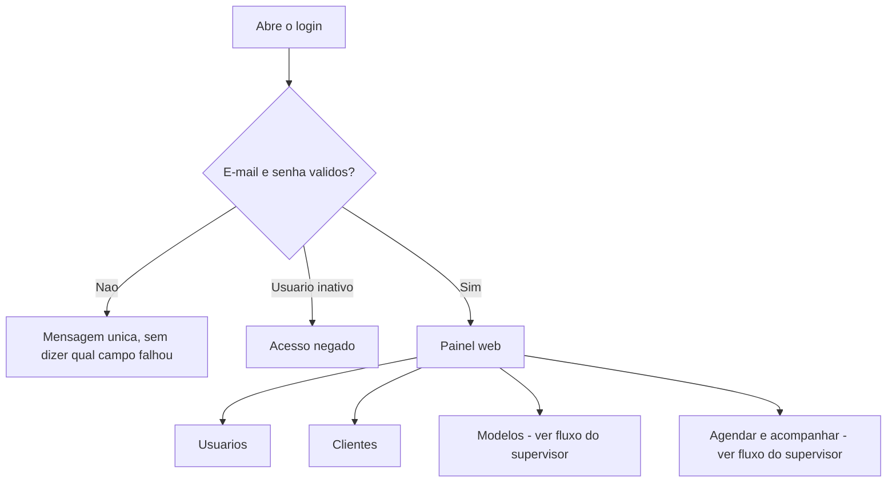
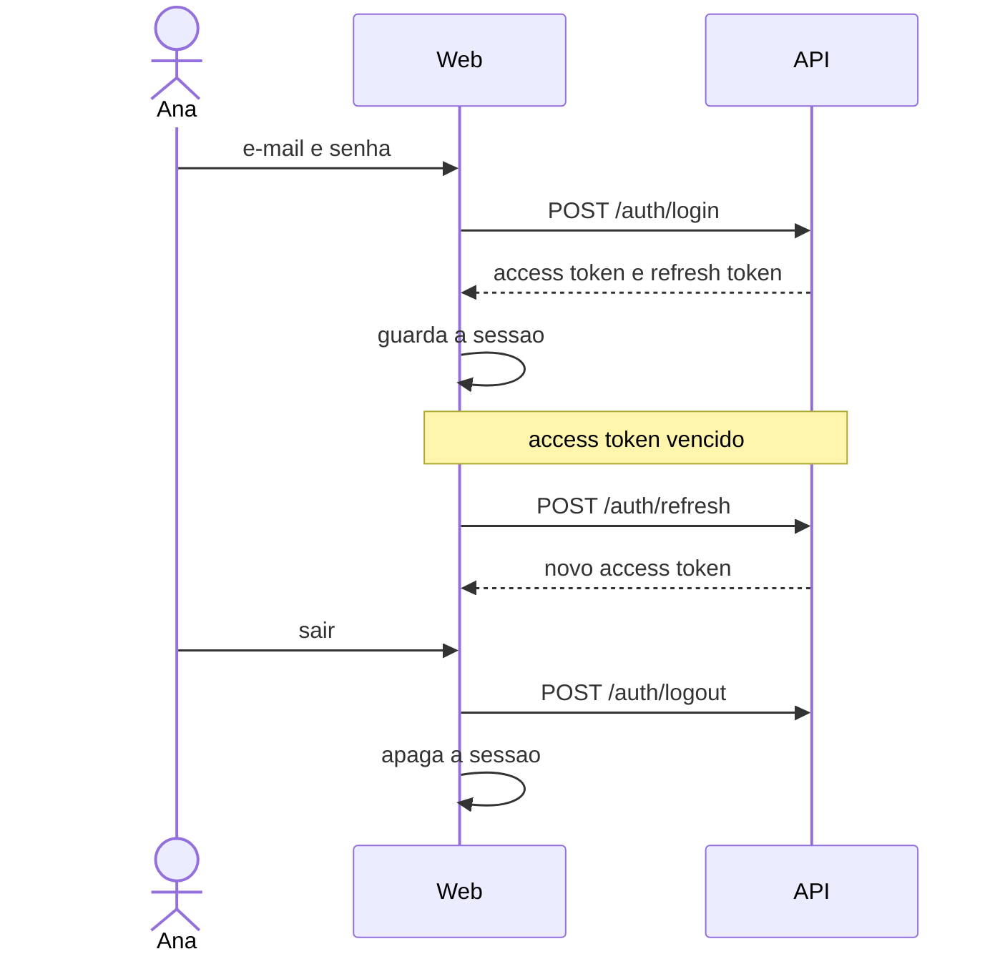
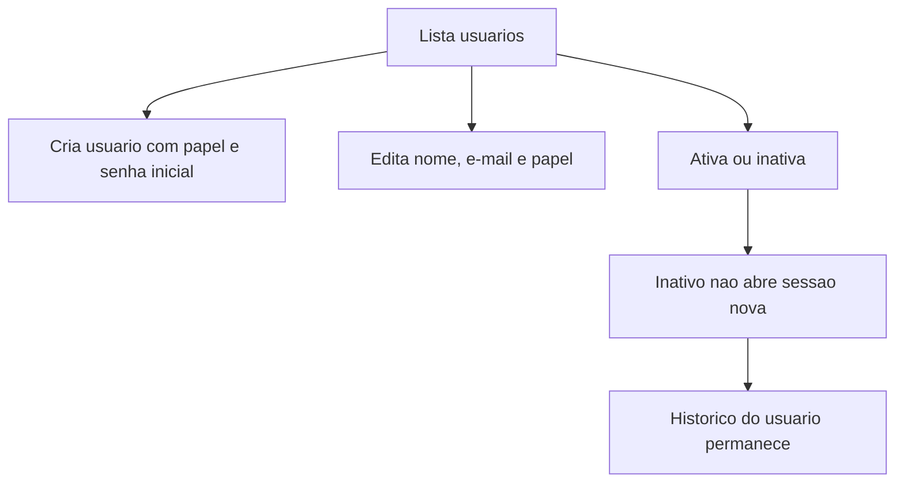
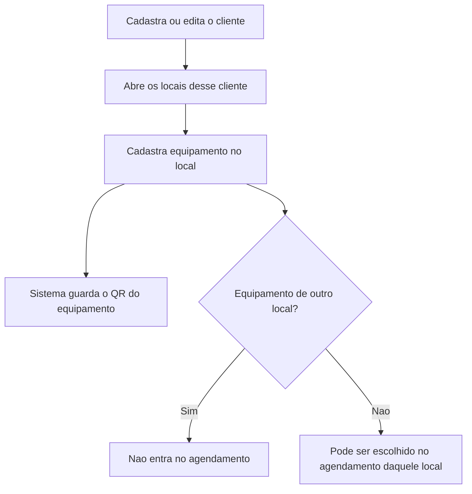

# Administrador

Ana entra no painel web, mantém quem acessa o sistema e o cadastro operacional que o supervisor usa para agendar.
Corte: 05/11/2026. Papel `ADMIN`. Canal: web.

O supervisor faz o mesmo cadastro de cliente, local e equipamento. Não faz a gestão de usuários.

## UC-01 — Entrar e sair

Disponível no web (PBI-0009, 0010) e no mobile do técnico (PBI-0008, 0010).

## UC-02 — Usuários

Disponível (PBI-0011, 0012). Só `ADMIN`.

Papéis que ele pode atribuir: `ADMIN`, `SUPERVISOR`, `TECHNICIAN`.

## UC-03 — Cliente, local e equipamento

Disponível (PBI-0013 a 0017). `ADMIN` e `SUPERVISOR`.

Lista de clientes, locais e equipamentos é paginada, com busca e filtro (PBI-0017).

## Ainda não entra neste fluxo

- Redefinir senha por e-mail. Há tela de "esqueci a senha" no web e no mobile; o contrato entregue até o PBI-0012 não fecha esse caso.
- Consulta de auditoria e indicadores (UC-18, UC-19).
- Papel de cliente somente leitura (UC-20).
