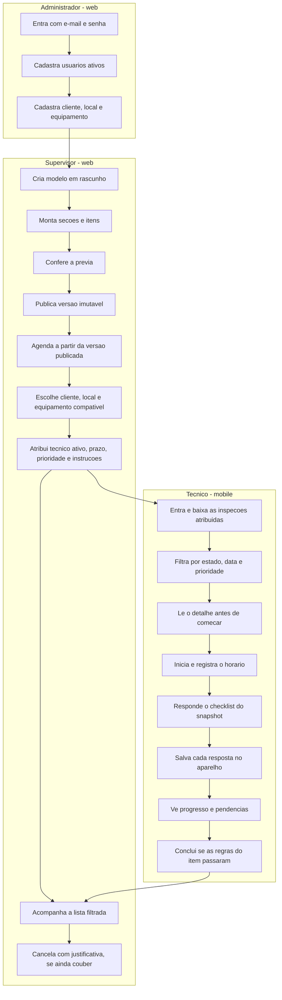
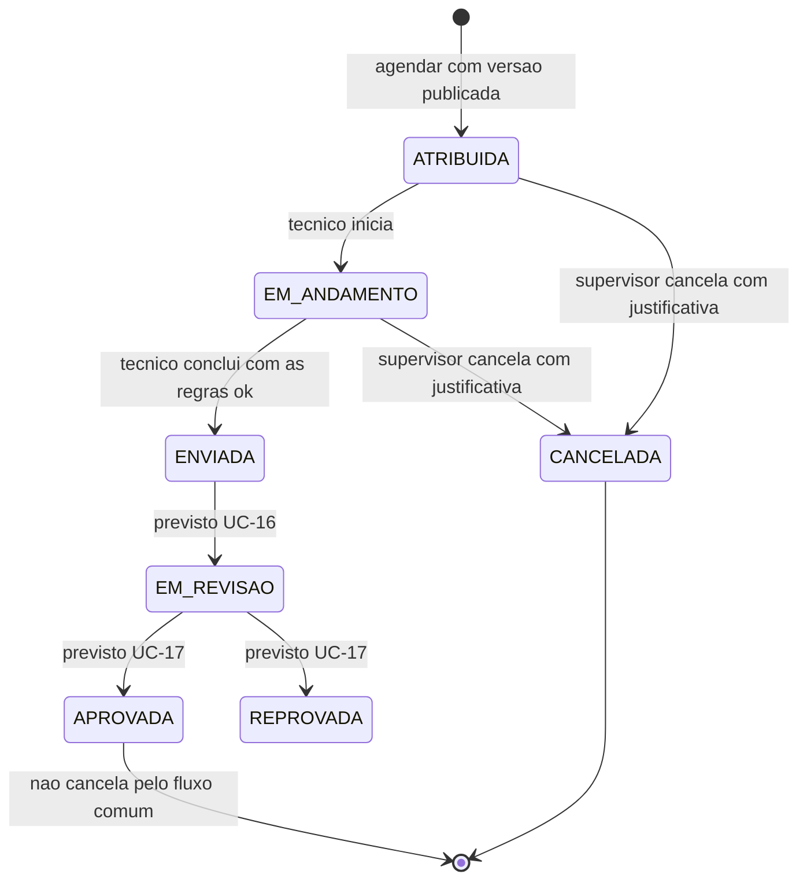

# Jornada entre os papéis

Como uma inspeção atravessa administrador, supervisor e técnico com o que está entregue até o PBI-0040.
Corte: 05/11/2026, até o PBI-0050. Atualizar quando um PBI mudar estado, canal ou ator.

O equipamento escolhido no agendamento fica registrado na tela. A API de agendamento ainda não recebe `equipmentId` (PBI-0026).

## Estado da inspeção hoje

Estados que a API já grava. Revisão, aprovação e reprovação existem no modelo, mas o fluxo do supervisor que os aciona ainda é PBI-0056 em diante.

## O que esta jornada ainda não desenha

| Depois de | Entra quando |
|---|---|
| Conclusão enviada | UC-14 sincronizar fila offline (PBI-0048 a 0055) |
| Inspeção enviada | UC-16 revisar e UC-17 aprovar ou reprovar (PBI-0056 a 0061) |
| Reprovação | Técnico recebe a correção no mobile (PBI-0062) |
