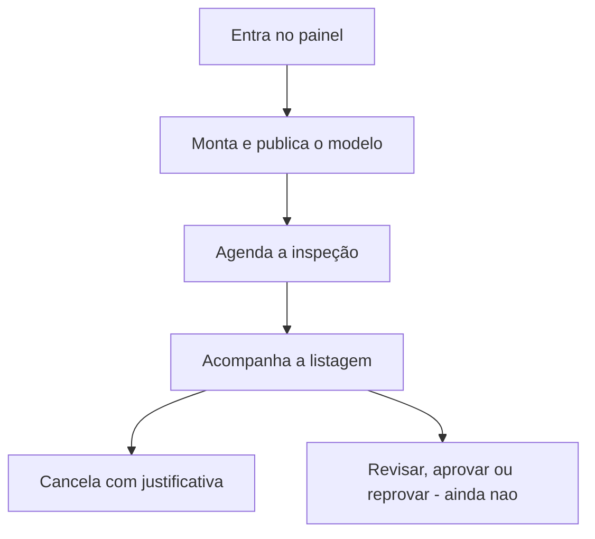
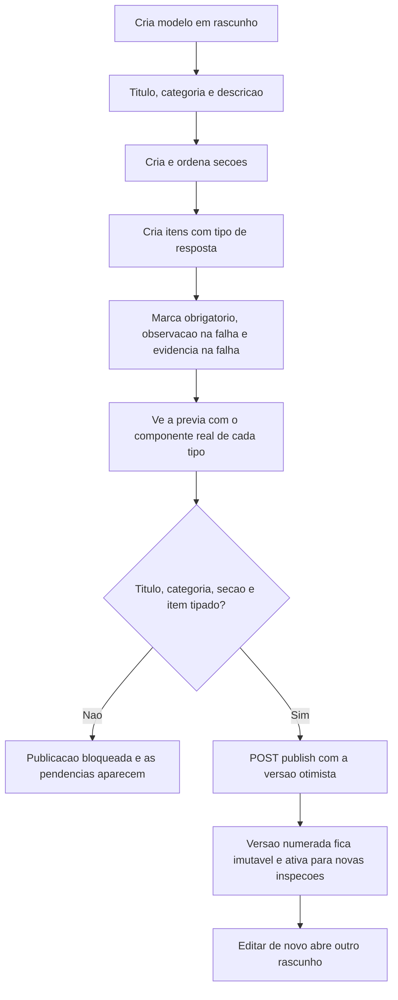
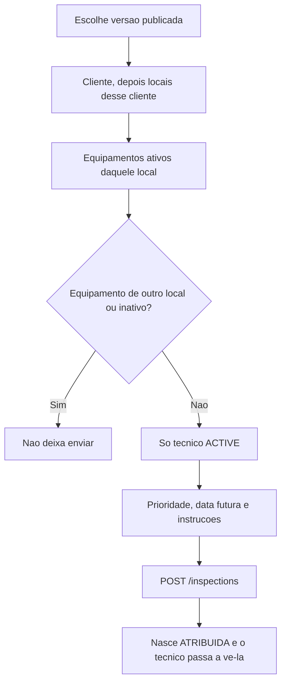

# Supervisor

Marina padroniza o checklist, agenda o trabalho do técnico e acompanha o que já foi atribuído ou concluído.
Corte: 05/11/2026, até o PBI-0050. Papel `SUPERVISOR`. Canal: web. O `ADMIN` percorre os mesmos passos, menos a restrição de não gerenciar usuários — isso é do administrador.



## UC-04 e UC-05 — Modelo e versão publicada

Disponível (PBI-0018 a 0023).



Tipos de item já aceitos: texto curto, texto longo, número, sim/não, conformidade, escolha única e data (PBI-0020).

## UC-06 — Agendar e atribuir

Disponível (PBI-0024 a 0028). O snapshot dos itens é copiado na criação (PBI-0024), inclusive as regras de observação e evidência na falha.



Trocar o técnico depois do agendamento usa `PATCH /inspections/{id}/assignee`, só em inspeção atribuída ou em rascunho, e só para técnico ativo (PBI-0027).

## UC-15 — Acompanhar e cancelar

Disponível (PBI-0029, 0030, 0047). No detalhe, o acompanhamento lista as fotos e as não conformidades já gravadas na API.

```mermaid
flowchart TD
  abre[Abre Inspecoes] --> api[GET /inspections paginado]
  api --> filtros[Filtra estado, periodo, tecnico e cliente]
  filtros --> detalhe[Abre a inspeção]
  detalhe --> campo[GET /inspections/{id}/monitoring]
  campo --> galeria[Lista fotos e nao conformidades sincronizadas]
  detalhe --> pode{Aprovada ou ja cancelada?}
  pode -->|Sim| semBotao[Nao oferece o cancelamento comum]
  pode -->|Nao| motivo[Pede justificativa obrigatoria]
  motivo --> grava[PATCH /cancel grava quem, quando e por que]
```

## Ainda não entra neste fluxo

| Caso | Por quê | PBI |
|---|---|---|
| UC-16 Revisar respostas e decidir | A galeria já mostra foto e não conformidade. Aprovar, reprovar e ampliar ainda não falam com a API | 0056–0058 |
| UC-17 Aprovar ou reprovar | Mesma lacuna. Inspeção aprovada já não cancela pelo fluxo comum | 0059–0061 |
| UC-18 Histórico e UC-19 Indicadores | Não entregues | 0063, 0073 |
| Equipamento no agendamento | O `POST /inspections` ainda não grava o equipamento. O técnico pode vinculá-lo depois, pelo QR do ativo do mesmo local | 0041 |
