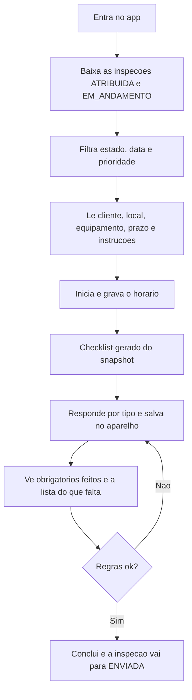
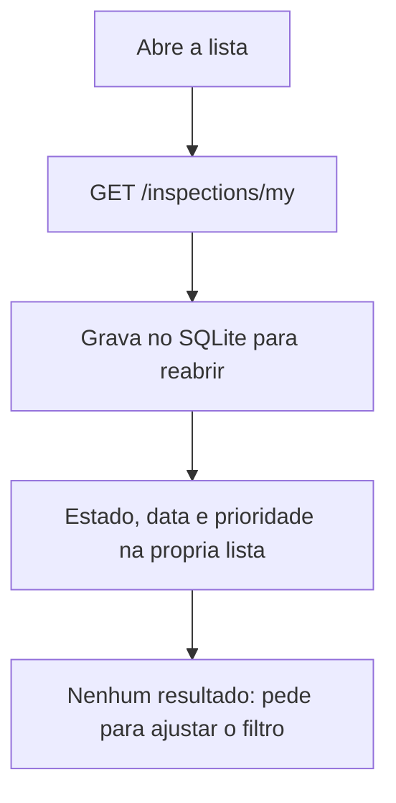
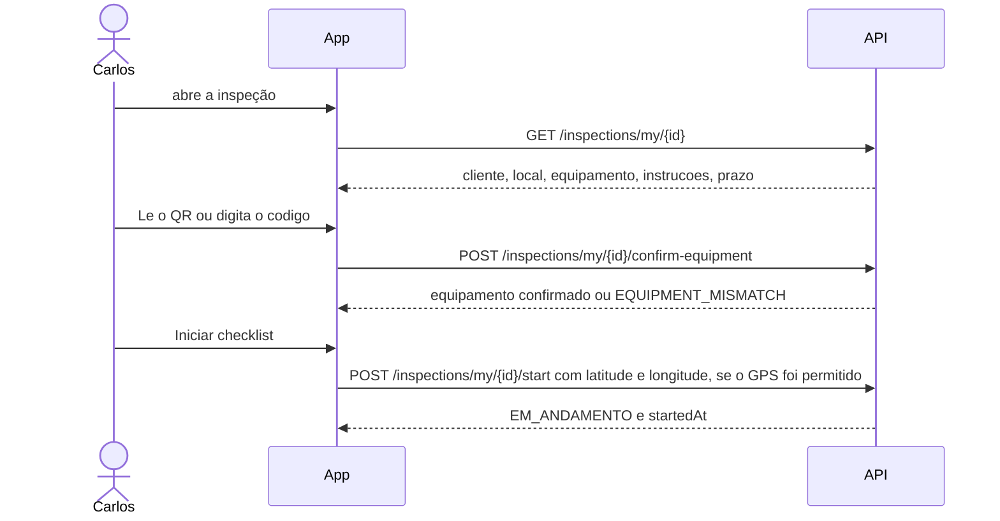
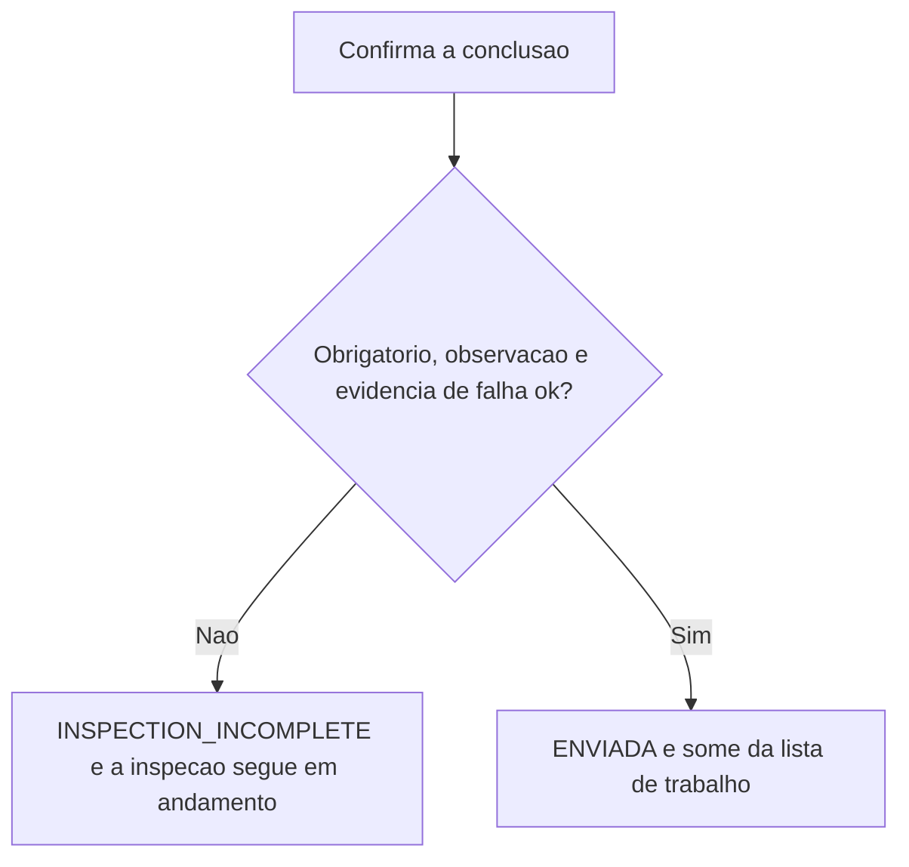
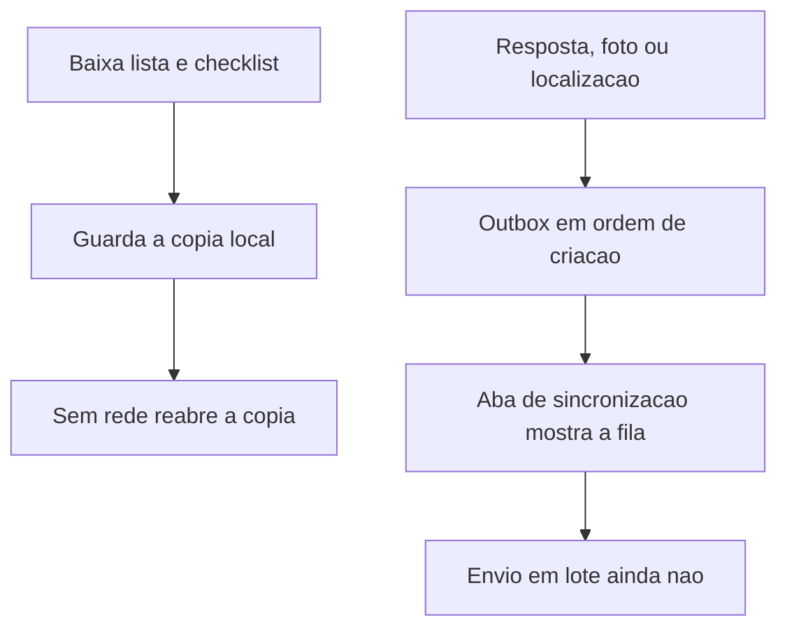

# Técnico

Carlos vê só o que foi atribuído a ele, executa o checklist no celular e só conclui quando as regras do item deixam.
Corte: 05/11/2026, até o PBI-0050. Papel `TECHNICIAN`. Canal: mobile.

O app abre em dados locais (`EXPO_PUBLIC_DATA_SOURCE` diferente de `api`). Os passos abaixo são os do modo API, que chama `GET/POST /inspections/my`. No modo local, a mesma navegação usa o fixture e o SQLite.



## UC-01 — Entrar

Disponível (PBI-0008, 0010). Sessão no aparelho. Access token vencido tenta refresh. Sem sessão prévia, sem rede não há o que abrir.

## UC-07 — Baixar e achar a inspeção

Disponível (PBI-0031, 0032). A lista não traz inspeção de outro técnico.



## UC-09 — Ver o detalhe e iniciar

Disponível (PBI-0033, 0034).



Iniciar de novo uma inspeção já em andamento não troca o horário. Inspeção que não está atribuída não inicia. Sem permissão de localização, o início segue e a tela avisa que foi sem coordenadas (PBI-0045). QR de outro ativo ou inativo não confirma (PBI-0041).

## UC-08 — Confirmar o equipamento

Disponível (PBI-0041). O código precisa ser de um equipamento ativo do mesmo local. Se a inspeção ainda não tinha equipamento, ela fica vinculada a esse ativo.

## UC-10 — Responder

Disponível (PBI-0035 a 0039).

```mermaid
flowchart TD
  snap[GET /inspections/my/{id}/checklist] --> tipos[Texto, texto longo, numero, sim/nao, conformidade, escolha, data]
  tipos --> cada[Cada mudanca grava o rascunho local]
  cada --> sobrevive[Fecha e abre de novo: as respostas continuam]
  cada --> obs[Observacao da nao conformidade vai no rascunho]
  cada --> barra[Barra e nomes dos obrigatorios pendentes]
```

O checklist é o snapshot copiado no agendamento. Mudar o modelo depois não muda esta inspeção (PBI-0024).

## UC-11 — Evidência

Disponível (PBI-0042 a 0044). A câmera mostra a prévia antes de confirmar. A foto aberta a partir de um item vai para esse item. Se o envio falha, o arquivo fica no aparelho com status pendente.

```mermaid
flowchart TD
  item[Adicionar foto no item] --> previa[Ve a previa e confirma]
  previa --> local[Grava o arquivo no aparelho]
  local --> envia[POST /inspections/my/{id}/items/{itemId}/evidence]
  envia -->|ok| pronta[Foto conta na conclusao]
  envia -->|falha| pendente[Continua no aparelho como pendente]
```

## UC-12 — Não conformidade

Disponível (PBI-0046). No item marcado como não conforme, o técnico escolhe a criticidade e a descrição. A API só grava se aquele item já tem uma foto enviada.

## UC-13 — Concluir

Disponível (PBI-0040, 0043, 0045). A API recusa a conclusão enquanto faltar resposta obrigatória, observação de falha ou evidência de falha. O app mostra essa recusa. A conclusão também envia as coordenadas, quando o GPS foi permitido.



## UC-14 — Sem rede e fila local

Parcial (PBI-0048 a 0050). Inspeção já baixada abre sem internet. Resposta, foto e localização entram numa outbox ordenada. O envio em lote, o cursor e o conflito ainda não saem do aparelho.



## Ainda não entra neste fluxo

| O que o técnico já vê na navegação | O que falta para o caso de uso | PBI |
|---|---|---|
| Aba de sincronização com a fila | Enviar o lote, cursor e conflito | 0051–0055 |
| — | Receber reprovação com instrução de correção | 0062 |
