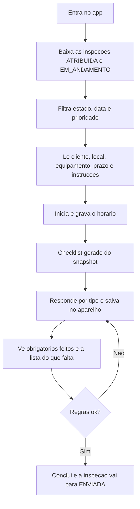
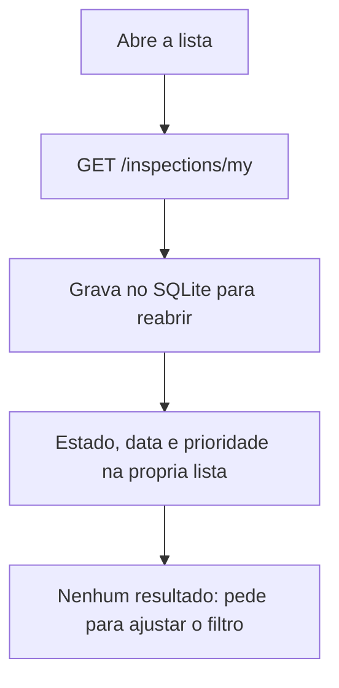
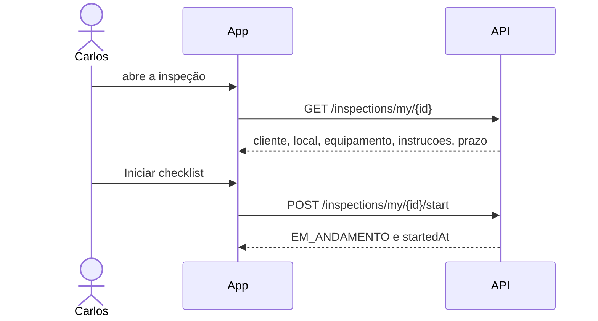
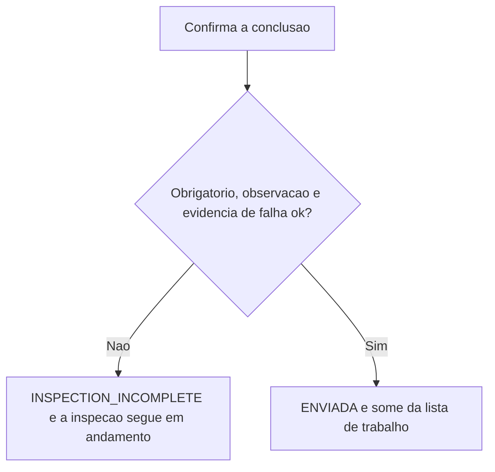

# Técnico

Carlos vê só o que foi atribuído a ele, executa o checklist no celular e só conclui quando as regras do item deixam.
Corte: 05/11/2026. Papel `TECHNICIAN`. Canal: mobile.

O app abre em dados locais (`EXPO_PUBLIC_DATA_SOURCE` diferente de `api`). Os passos abaixo são os do modo API, que chama `GET/POST /inspections/my`. No modo local, a mesma navegação usa o fixture e o SQLite.



## UC-01 — Entrar

Disponível (PBI-0008, 0010). Sessão no aparelho. Access token vencido tenta refresh. Sem sessão prévia, sem rede não há o que abrir.

## UC-07 — Baixar e achar a inspeção

Disponível (PBI-0031, 0032). A lista não traz inspeção de outro técnico.



## UC-09 — Ver o detalhe e iniciar

Disponível (PBI-0033, 0034).



Iniciar de novo uma inspeção já em andamento não troca o horário. Inspeção que não está atribuída não inicia.

## UC-10 — Responder

Disponível (PBI-0035 a 0039).

```mermaid
flowchart TD
  snap[GET /inspections/my/{id}/checklist] --> tipos[Texto, texto longo, numero, sim/nao, conformidade, escolha, data]
  tipos --> cada[Cada mudanca grava o rascunho local]
  cada --> sobrevive[Fecha e abre de novo: as respostas continuam]
  cada --> obs[Observacao da nao conformidade vai no rascunho]
  cada --> barra[Barra e nomes dos obrigatorios pendentes]
```

O checklist é o snapshot copiado no agendamento. Mudar o modelo depois não muda esta inspeção (PBI-0024).

## UC-13 — Concluir

Parcial (PBI-0040). A API recusa a conclusão enquanto faltar resposta obrigatória, observação de falha ou evidência de falha. O app mostra essa recusa.



A evidência em si ainda não sobe para a API. Se o item exige foto na falha, a conclusão permanece bloqueada até o PBI-0043. Foto, localização e QR hoje ficam no rascunho do aparelho.

## Ainda não entra neste fluxo

| O que o técnico já vê na navegação | O que falta para o caso de uso | PBI |
|---|---|---|
| Botão de QR Code | Confirmar o equipamento da inspeção contra o cadastro | 0041 |
| Botão de foto e prévia local | Associar o arquivo ao item e enviar | 0042–0044 |
| Registro local de não conformidade | CRUD da não conformidade na API | 0046 |
| Aba de sincronização | Fila, lote, cursor e conflito | 0048–0055 |
| — | Receber reprovação com instrução de correção | 0062 |
