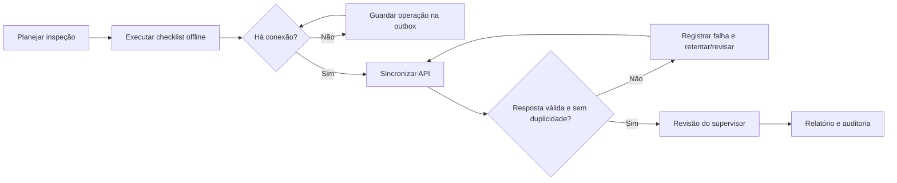

# Análise de Qualidade — Sete Ferramentas

Aplicação das sete ferramentas básicas de qualidade ao FieldOps. Destina-se à equipe, ao QA e ao sponsor; revisar a cada ciclo de testes e homologação.

> Os números deste documento são uma linha de base didática estimada, pois o repositório ainda não consolida histórico de defeitos. Substituí-los por evidências de testes, auditoria e homologação assim que disponíveis.

## 1. Fluxograma

Ponto crítico: a transição entre outbox e API deve preservar idempotência e evidências.

## 2. Folha de verificação

A folha abaixo simula 30 ocorrências encontradas em testes de integração; a coluna “real” deve ser preenchida no próximo ciclo.

| Tipo de não conformidade | Ocorrências estimadas | Campo para ocorrência real |
|---|---:|---|
| Falha de sincronização/reenvio | 9 |  |
| Contrato API divergente | 7 |  |
| Validação de formulário | 5 |  |
| Permissão/autorização | 4 |  |
| Evidência fotográfica | 3 |  |
| Desempenho/consulta | 2 |  |
| **Total** | **30** |  |

## 3. Diagrama de Pareto

| Ordem | Categoria | Ocorrências | % acumulado |
|---:|---|---:|---:|
| 1 | Sincronização/reenvio | 9 | 30,0% |
| 2 | Contrato API | 7 | 53,3% |
| 3 | Validação de formulário | 5 | 70,0% |
| 4 | Permissão | 4 | 83,3% |
| 5 | Evidência | 3 | 93,3% |
| 6 | Desempenho | 2 | 100,0% |

Prioridade: atacar sincronização, contrato e validações, que concentram 70% das ocorrências estimadas.

## 4. Diagrama de causa e efeito

**Efeito analisado: inspeção não sincronizada ou inconsistente.**

| Categoria | Causas potenciais |
|---|---|
| Método | Retentativa sem regra definida; conflito sem tratamento |
| Máquina/tecnologia | Rede instável; versão incompatível do app ou API |
| Mão de obra | Uso incorreto do fluxo; revisão insuficiente do contrato |
| Material/dados | Payload incompleto; foto grande; identificador duplicado |
| Medição | Ausência de métricas de fila, falha e tempo de sincronização |
| Ambiente | Área sem conectividade; bateria insuficiente do dispositivo |

## 5. Histograma

Distribuição estimada de 20 tempos de sincronização bem-sucedida (segundos).

| Faixa | Frequência |
|---|---:|
| 0–2 s | 5 |
| 3–5 s | 8 |
| 6–8 s | 4 |
| 9–11 s | 2 |
| 12 s ou mais | 1 |

Critério inicial: investigar amostras acima de 8 s e definir meta após medição real em campo.

## 6. Diagrama de dispersão

Variáveis a registrar: tamanho total das evidências (MB) × tempo de sincronização (s). A hipótese é correlação positiva: arquivos maiores elevam o tempo. Cada teste deve registrar os dois valores; se a tendência se confirmar, aplicar compressão/limite de upload e envio em etapas.

## 7. Gráfico de controle

Indicador: percentual de sincronizações com sucesso por execução diária. Linha central inicial: 95%; limite de alerta inferior: 90%; meta: ≥ 98% após estabilização. Pontos abaixo do limite, sete pontos consecutivos em queda ou qualquer alteração relevante no contrato devem abrir investigação e ação corretiva.

## Ações e acompanhamento

| Ação | Responsável | Evidência |
|---|---|---|
| Executar testes de reenvio/idempotência | QA e Dev Mobile/Backend | Casos automatizados e relatório |
| Validar OpenAPI antes da integração | ARQ e Devs | Contrato versionado e CI verde |
| Medir falhas e tempo de sincronização | QA | Folha de verificação preenchida |
| Revisar Pareto e limites | GP/QA | Ata semanal e atualização deste documento |
