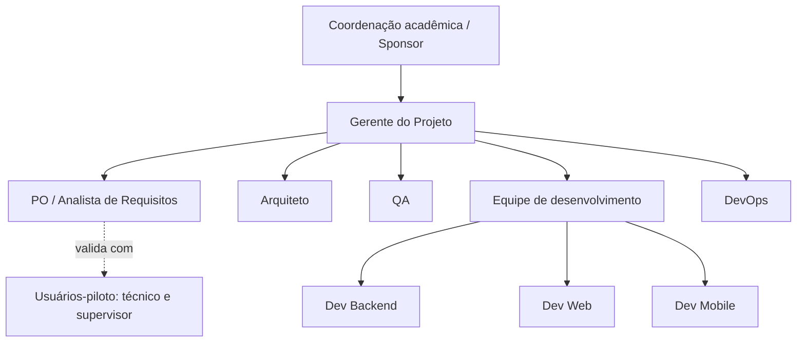

# Organograma e Matriz RACI

Estrutura de governança e responsabilidades do FieldCore. Atualizar quando houver alteração de papéis ou de escopo.

## Organograma

Legenda: **R** executa; **A** aprova/responde pelo resultado; **C** é consultado; **I** é informado. Há apenas um A por atividade.

| Entrega/atividade | Sponsor | GP | PO/AR | ARQ | Backend | Web | Mobile | QA | DevOps | Usuários-piloto |
|---|---|---|---|---|---|---|---|---|---|---|
| TAP, escopo e mudanças relevantes | A | R | C | C | I | I | I | I | I | C |
| Requisitos, personas e backlog | I | A | R | C | C | C | C | C | I | C |
| Arquitetura, modelo de dados e OpenAPI | I | A | C | R | R | C | C | C | C | I |
| Implementação da API | I | A | I | C | R | I | I | C | C | I |
| Implementação do painel web | I | A | C | C | I | R | I | C | I | C |
| Implementação do app mobile/offline | I | A | C | C | I | I | R | C | I | C |
| CI/CD e ambientes | I | A | I | C | C | C | C | C | R | I |
| Testes, métricas e correção | I | A | C | C | R | R | R | R | C | C |
| Homologação | I | A | R | C | C | C | C | C | I | R |
| Go-live e encerramento | A | R | C | C | C | C | C | C | R | I |

## Alocação nominal na execução

O TAP prevê gerência em revezamento por sprint. A atuação real de cada integrante foi levantada nas issues atribuídas (por componente) e nos pull requests integrados da organização Project-FieldCore até 27/11/2026.

| Integrante | Papéis exercidos | Issues atribuídas | PRs integrados |
|---|---|---|---|
| Gustavo Sousa | Orquestração do backlog e das convenções (ADR 0001), CI/DevOps, sincronização e revisão na API, apoio ao mobile | 81 (API 33, mobile 36, web 10, docs 2) | 89 |
| Giovana Rafaela | Dev Backend: domínio, cadastros, modelos e inspeções na API | 70 (API 58) | 28 |
| Juliana Nascimento | Dev Mobile: app do técnico, checklist e recursos nativos; elaboração do TAP | 57 (mobile 47) | 7 |
| Maria Eduarda | Dev Web: painel administrativo (cadastros, modelos, revisão) e endpoints de apoio | 54 (web 38, API 12) | 19 |
| Milenna Portella | Entrega e qualidade: build Android, dados de demonstração, OpenAPI, testes dos fluxos críticos; telas web e P1 mobile (assinatura, tema escuro) | 23 (web 9, mobile 9, API 3) | 0 |

Mapeamento para a RACI: **Backend** = Giovana Rafaela; **Web** = Maria Eduarda; **Mobile** = Juliana Nascimento; **DevOps** e coordenação técnica = Gustavo Sousa; **QA/entrega** = Milenna Portella. GP e PO foram exercidos de forma compartilhada, em revezamento, conforme o TAP. Uma issue pode ter mais de um responsável, e trabalho feito sem issue ou PR próprio não aparece nas contagens.
