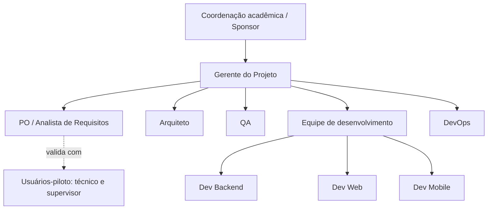

# Organograma e Matriz RACI

Estrutura de governança e responsabilidades do FieldOps. Atualizar quando os papéis forem atribuídos nominalmente ou houver alteração de escopo.

## Organograma

Legenda: **R** executa; **A** aprova/responde pelo resultado; **C** é consultado; **I** é informado. Há apenas um A por atividade.

| Entrega/atividade | Sponsor | GP | PO/AR | ARQ | Backend | Web | Mobile | QA | DevOps | Usuários-piloto |
|---|---|---|---|---|---|---|---|---|---|---|
| TAP, escopo e mudanças relevantes | A | R | C | C | I | I | I | I | I | C |
| Requisitos, personas e backlog | I | A | R | C | C | C | C | C | I | C |
| Arquitetura, modelo de dados e OpenAPI | I | A | C | R | R | C | C | C | C | I |
| Implementação da API | I | A | I | C | R | I | I | C | C | I |
| Implementação do painel web | I | A | C | C | I | R | I | C | I | C |
| Implementação do app mobile/offline | I | A | C | C | I | I | R | C | I | C |
| CI/CD e ambientes | I | A | I | C | C | C | C | C | R | I |
| Testes, métricas e correção | I | A | C | C | R | R | R | R | C | C |
| Homologação | I | A | R | C | C | C | C | C | I | R |
| Go-live e encerramento | A | R | C | C | C | C | C | C | R | I |
